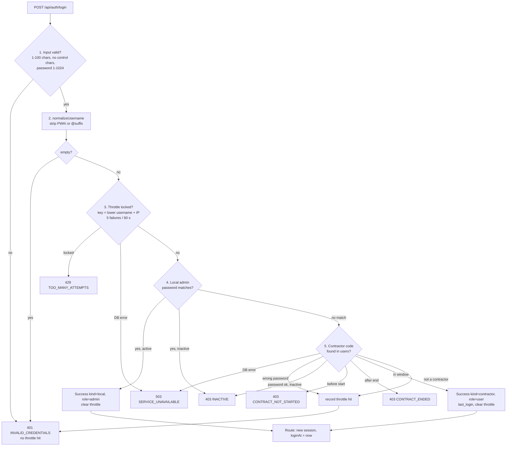

# Login flows

Two entry points share the session rules in `src/lib/session-core.ts`:

- Employees: r6auth SSO (`/api/auth/sso/login` → r6auth → `/api/auth/sso/callback`, logic in
  `attemptSsoLogin`, `src/lib/auth/sso-login.ts`).
- Contractors and local admins: password form (`POST /api/auth/login`, logic in `attemptLogin`,
  `src/lib/auth/login.ts`).

Route handlers map results to HTTP / redirects and write the session cookie; the services touch neither.

## SSO (`attemptSsoLogin`)

```mermaid
flowchart TD
    A[GET /api/auth/sso/login?from=] --> B[random state, sealed cookie name_sso<br/>state + safe from, 10 min, path /api/auth/sso]
    B --> C{R6AUTH_FAKE active?}
    C -->|yes| D[/dev/sso?state=]
    C -->|no| E[r6auth authorize.php]
    D --> F[GET /api/auth/sso/callback?code&state]
    E --> F
    F --> H{valid session already?}
    H -->|yes| P[/profile, clear name_sso]
    H -->|no| G{cookie readable?}
    G -->|no| X1[/login?error=SSO_EXPIRED<br/>token.php not called]
    G -->|yes| S{state present and<br/>matches timing-safe?}
    S -->|no: another tab's attempt| X0[/login?error=SSO_EXPIRED<br/>keep name_sso for that tab]
    S -->|yes| I[clear name_sso from here on]
    I --> Q{code present,<br/>no error param?}
    Q -->|no| X1
    Q -->|yes| J[POST token.php with client_secret]
    J -->|invalid_grant| X1
    J -->|network, timeout, invalid_client,<br/>slow_down, bad shape| X2[/login?error=SERVICE_UNAVAILABLE]
    J -->|200| K{username present and<br/>expires_at in the future?}
    K -->|no: same rule as isSessionValid| X2
    K -->|yes| L{R6AUTH_ALLOWED_BA set<br/>and ba not in it?}
    L -->|yes| X3[/login?error=NOT_ALLOWED<br/>no users row written]
    L -->|no| M[syncSsoUser: upsert profile,<br/>base role, cost center roles]
    M -->|DB error| X2
    M -->|employee code is a contractor's username| X7[/login?error=ACCOUNT_CONFLICT]
    M --> N{account state}
    N -->|is_active = false| X4[/login?error=INACTIVE]
    N -->|pending| X5[/login?error=PENDING_APPROVAL]
    N -->|rejected| X6[/login?error=REJECTED]
    N -->|approved| OK[new session: kind=sso, loginAt,<br/>expiresAt = r6auth expires_at]
    OK --> R[redirect to from]
```

The login button links to the origin of `R6AUTH_REDIRECT_URI` (relative in fake mode), so the
state cookie is set on the host the callback returns to, even if the page was opened by IP or a
short host name.

No throttle on this path: there is no password. r6auth rate-limits bad client secrets itself.

## Password (`attemptLogin`)



## What counts toward the throttle

Only a failed password attempt: a wrong local admin or contractor password, or a username that matches
neither (employees must use SSO). Invalid input, DB errors, inactive accounts and contract window
failures do not count. A successful login clears the counter.

## Notes

- Local admin is checked first and needs nothing but the database, so it works while r6auth is down.
- The BA allow-list runs before any row is written: a disallowed employee is never created.
- Pending, rejected and inactive SSO users are persisted (so an admin can see and approve them) but
  do not get a session.
- The client sees a generic Thai message; details go to the server log (never the password, the
  authorization code or the client secret).
